<p align="center">
  <picture>
    <source media="(prefers-color-scheme: dark)" srcset="docs/brand/logo-dark.svg">
    
  </picture>
</p>

<p align="center">
  <strong>Le gestionnaire auto-hébergé de votre parc de serveurs Linux.</strong><br>
  Santé, inventaire, vulnérabilités, Docker et clés SSH — sans agent, en lecture seule, par SSH.
</p>

<p align="center">
  <a href="https://github.com/elio-fleet/elio/actions/workflows/ci.yml"></a>
  <a href="https://github.com/elio-fleet/elio/releases"></a>
  <a href="LICENSE"></a>
  <a href="https://github.com/elio-fleet/elio/pkgs/container/elio"></a>
</p>

<p align="center">
  <a href="https://elio-fleet.github.io/elio/fr/">Site</a> ·
  <a href="#démarrage-rapide">Démarrage rapide</a> ·
  <a href="#fonctionnalités">Fonctionnalités</a> ·
  <a href="#extensions">Extensions</a> ·
  <a href="#sécurité">Sécurité</a> ·
  <a href="README.md">English</a>
</p>

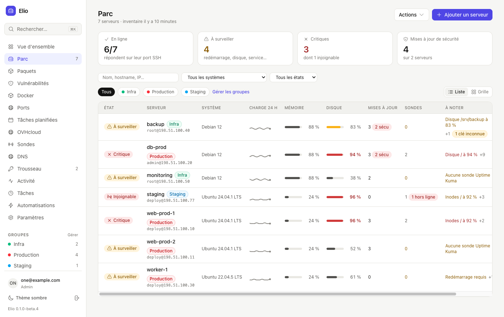

Elio suit un parc de serveurs Debian et Ubuntu depuis un seul endroit : lesquels vont bien, ce qui tourne dessus, quels paquets sont vulnérables et comment les corriger, qui a une clé SSH dessus. Rien à installer sur les serveurs : Elio s'y connecte avec sa propre clé SSH et lance une courte liste de **commandes en lecture seule**, toutes écrites dans un seul fichier à relire — [`config/ssh_commands.yml`](config/ssh_commands.yml).

> **Bêta.** Elio est jeune (`v0.1.0-beta.4`). Il tourne sur de vrais serveurs, mais attendez-vous à quelques aspérités, et lisez les [limites connues](#limites-connues).

## Fonctionnalités

| | |
|---|---|
| **Santé** | Charge, mémoire, swap, disques et inodes, redémarrage requis, services en échec, horloge, mises à jour en attente — avec vos seuils et 30 jours d'historique. |
| **Inventaire** | Système et date de fin de support, adresses réseau (WireGuard compris), paquets (dpkg, snap), services systemd, **Docker** (conteneurs, images, projets Compose), **tâches planifiées** (cron, timers systemd), ports en écoute, et un onglet **Firewall** : le firewall du serveur (ufw, nftables, iptables) et celui d'OVHcloud côte à côte pour chaque port public, avec des règles ufw à copier — SSH ouvert seulement aux sources que vous listez, IPv6 entrant bloqué si vous le voulez. |
| **Vulnérabilités** | Les CVE de chaque paquet, d'après le Debian Security Tracker et les données OSV d'Ubuntu, rapprochées de l'inventaire — aucune commande de plus sur les serveurs ; les paquets signés (grub, shim, noyau, fwupd) comparés au code qu'ils signent. Regroupées **par paquet, avec la mise à jour à faire**, celles du serveur à part de celles de ses images Docker, et **les commandes pour corriger une CVE** (`apt-get install --only-upgrade …`, ou `docker compose pull` et `up -d` pour une image) — à copier, jamais lancées par Elio. Notes de NVD, Red Hat et CVE.org (ou de vos propres fournisseurs), exploitation d'après EPSS et le catalogue CISA KEV. |
| **Docker** | Conteneurs en mauvaise santé ou qui redémarrent en boucle, images par serveur, **nouvelles versions publiées sur les registres** (Docker Hub, GHCR, Quay, registres privés), vulnérabilités des images (Trivy ou Grype s'ils sont installés, sinon le rapprochement d'Elio) dans un onglet **CVE** : par image, avec les serveurs et conteneurs qui l'utilisent. |
| **Clés SSH** | Un trousseau commun (personnes et machines), des clés ajoutées ou retirées d'un serveur en un clic, des **accès temporaires** qui expirent tout seuls, **les clés de tous les comptes** d'un serveur (avec root), les clés inconnues signalées et réunies dans une liste **Hors trousseau**, la rotation de la clé d'Elio sans coupure. |
| **Alertes** | Ce qui demande votre attention, par gravité, sur la vue d'ensemble ; journal d'activité ; notifications Slack, Discord, email ou webhook signé, regroupées par type (les critiques tout de suite) ; résumé quotidien. |
| **Automatisations** | Chaque collecte tourne à la fréquence voulue, sur tout le parc ou par groupe, suivie en direct dans la page *Tâches*. |
| **Extensions** | **Uptime Kuma** (sondes rattachées à chaque serveur), **OVHcloud** (IP, firewall réseau, enregistrements DNS, services), **Technitium DNS** (zones et enregistrements) et **Gandi** (enregistrements LiveDNS, domaines et leur expiration), en lecture seule, avec **un DNS du parc** et des **prompts pour une IA** (sondes à créer, règles de firewall) qui se terminent par vos propres consignes. |
| **Équipe** | Rôles (admin, opérateur, lecture), invitations, double authentification obligatoire, **des notes sur chaque serveur** (Markdown), recherche ⌘K partout, thèmes clair et sombre. |

| | |
|:---:|:---:|
| 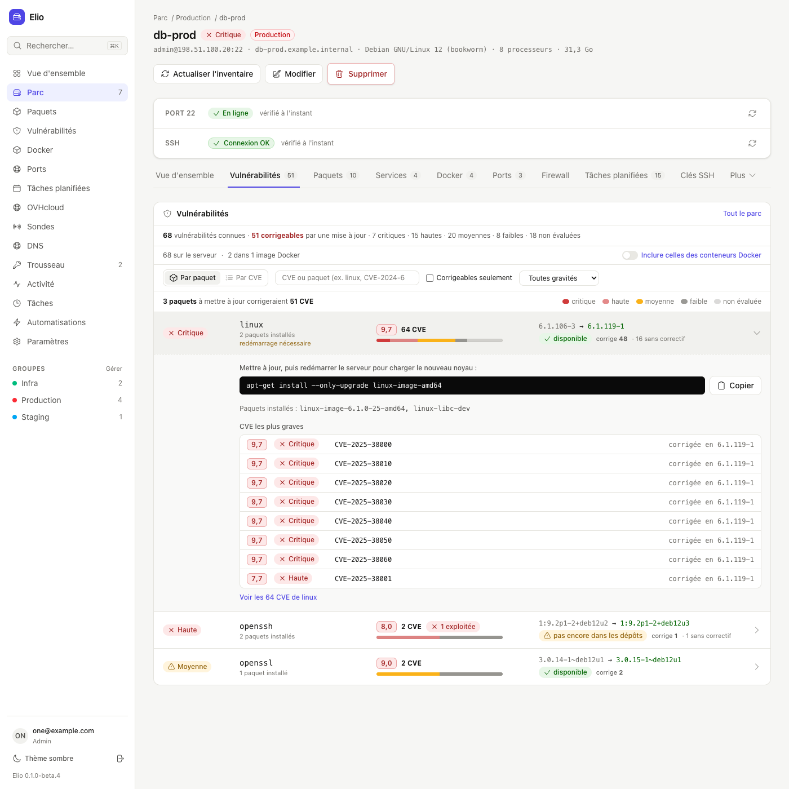 | 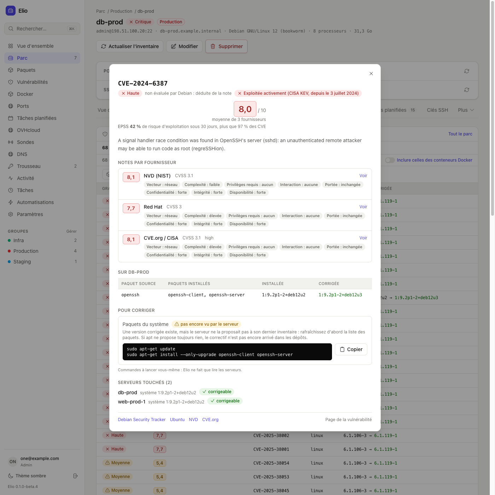 |
| **Vulnérabilités par paquet**, avec la mise à jour à faire | **Une CVE en détail** : notes par fournisseur, vecteur CVSS en clair |
| 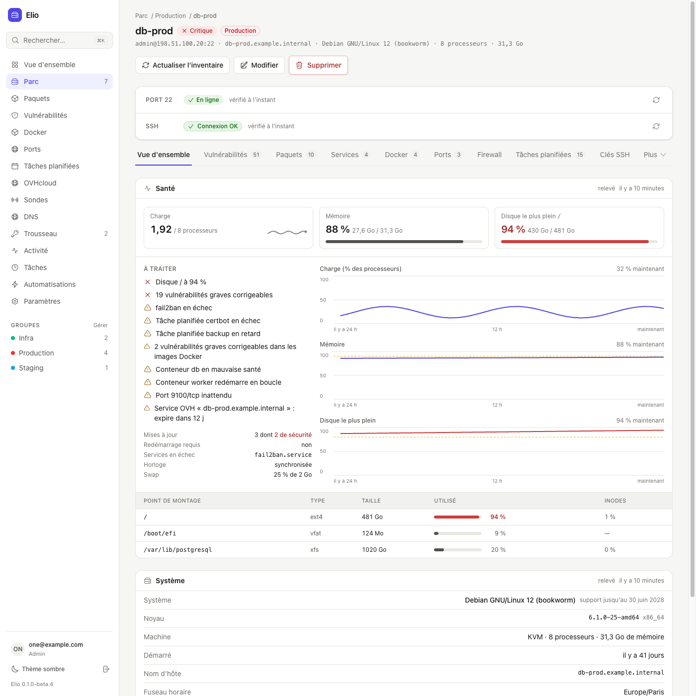 | 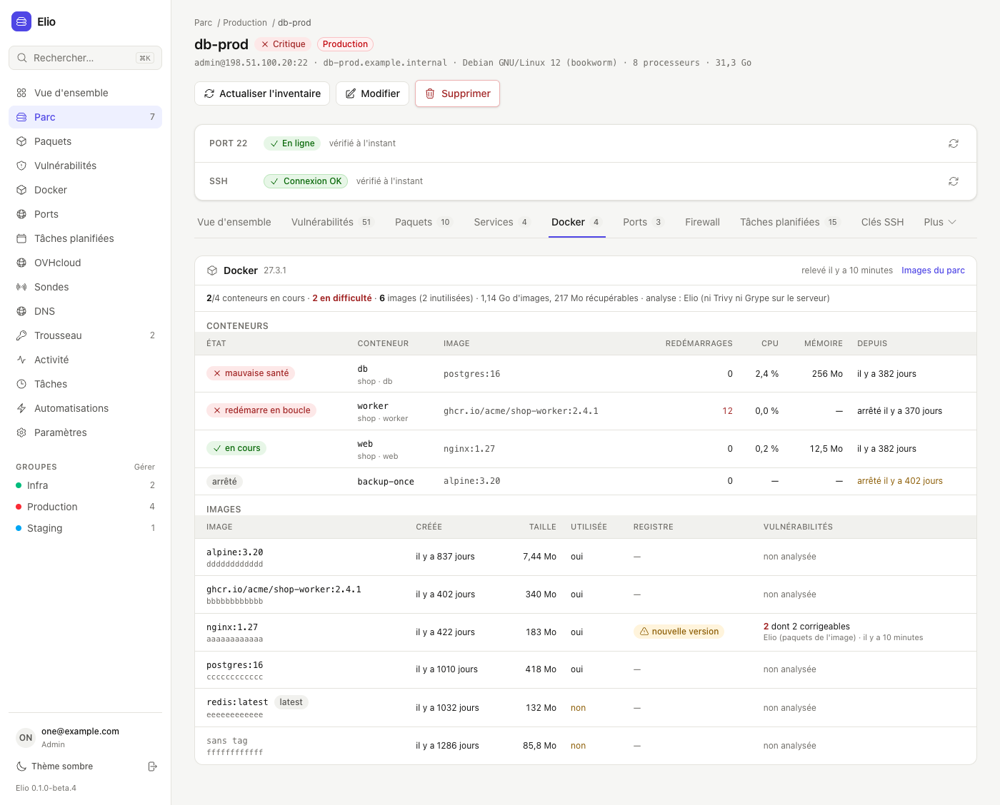 |
| **Un serveur** : santé, courbes sur 24 h, système | **Docker** : conteneurs, images, mises à jour, CVE |
| 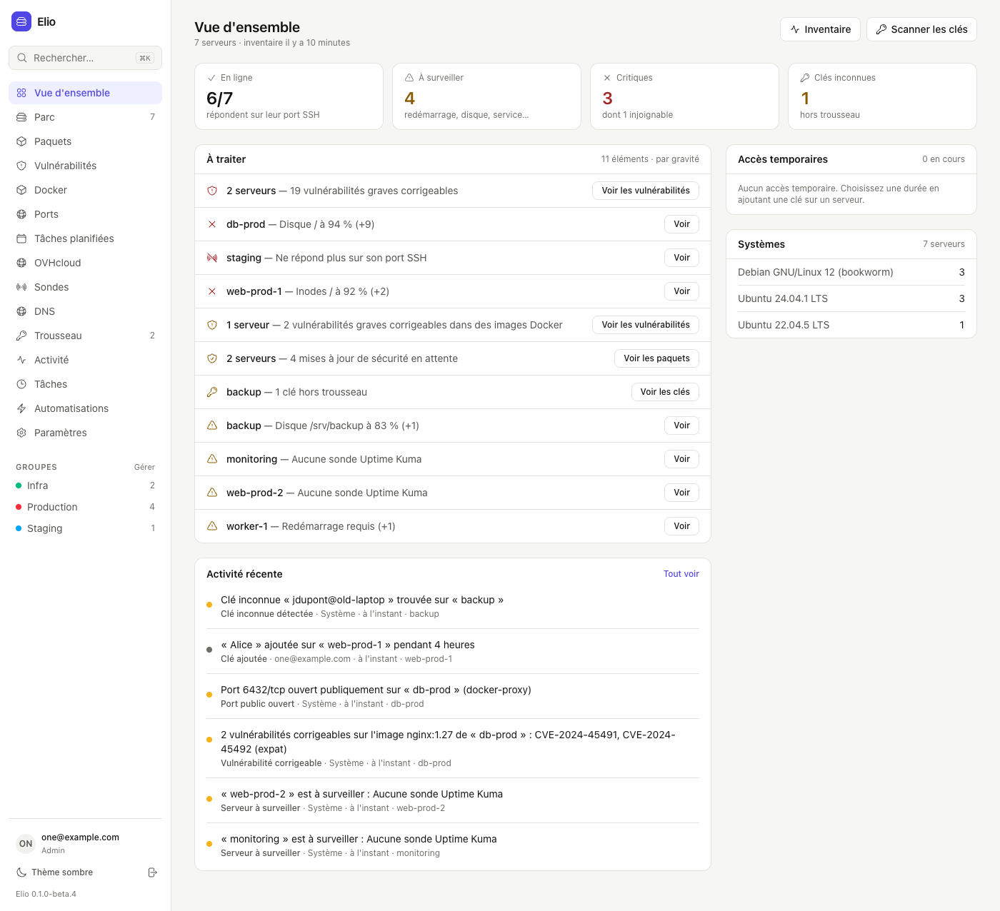 | 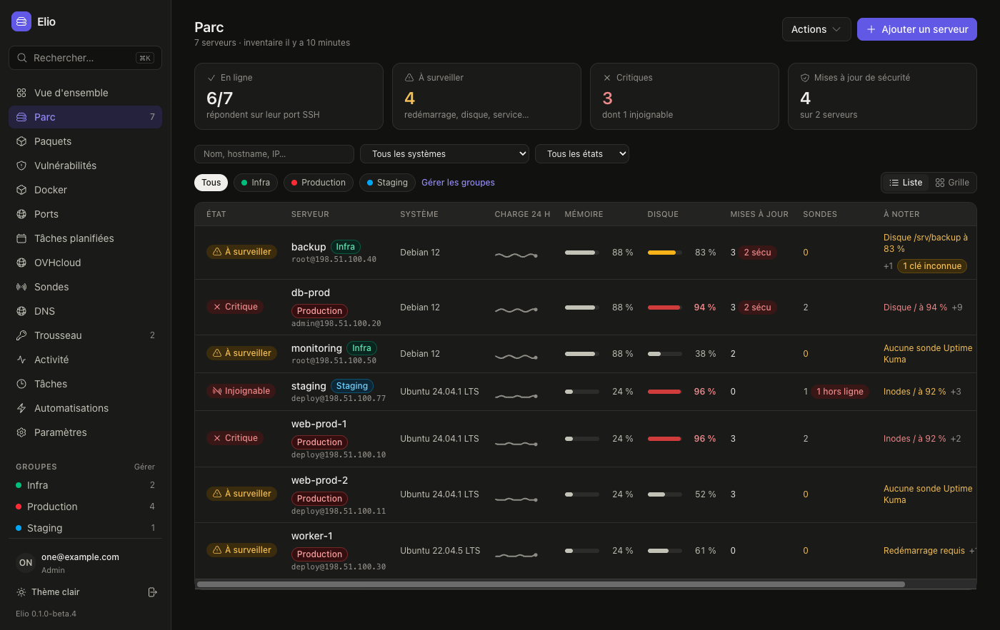 |
| **Ce qui est à traiter**, le plus grave d'abord | **Thème sombre** |
| 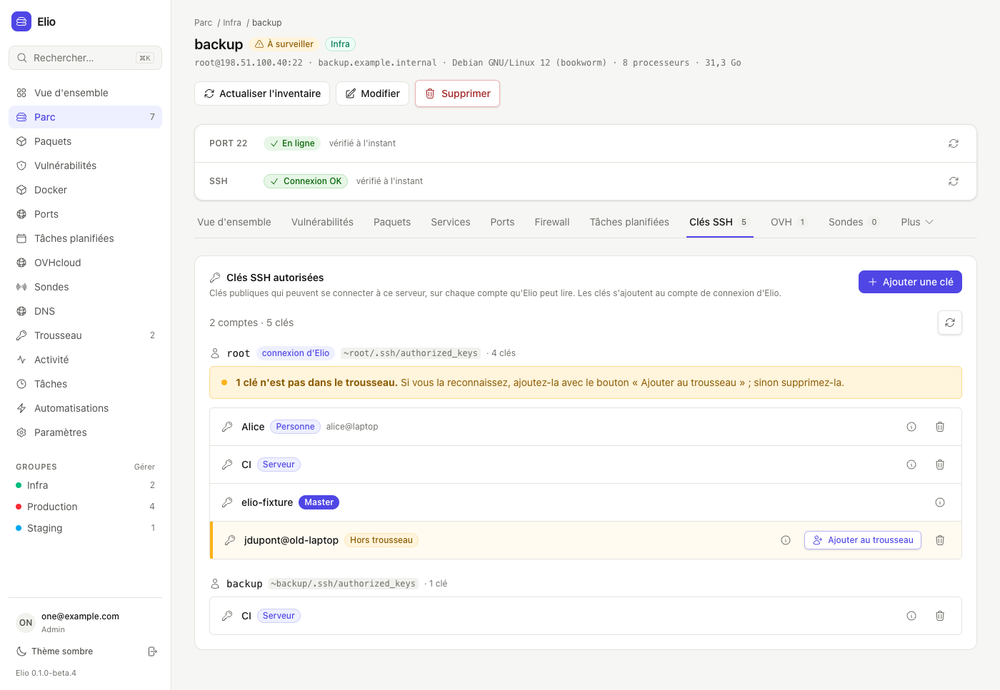 | 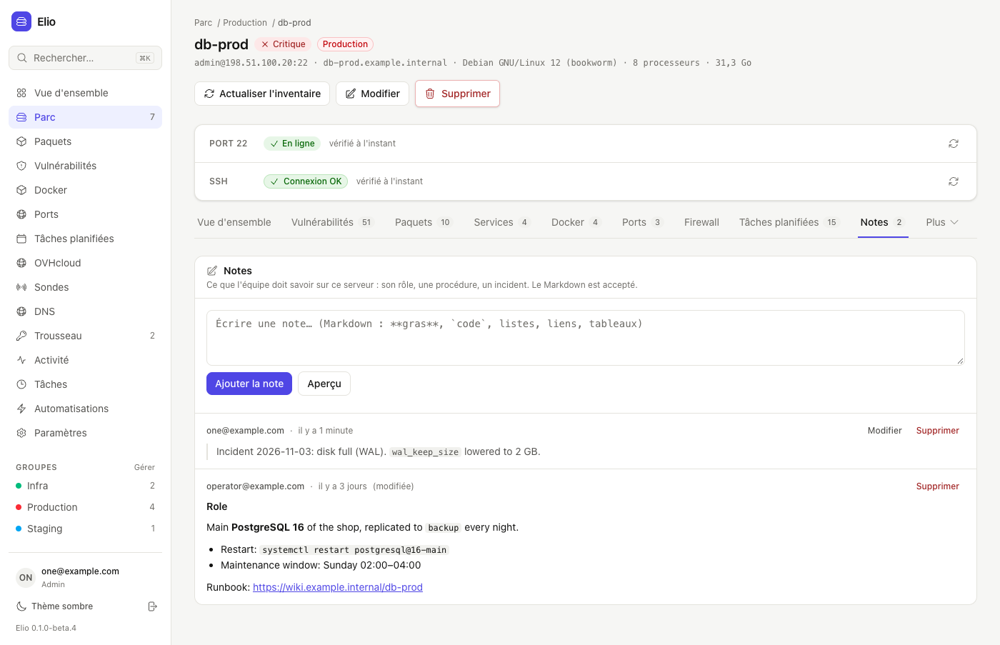 |
| **Clés SSH** de tous les comptes d'un serveur | **Notes** de l'équipe sur un serveur |
| 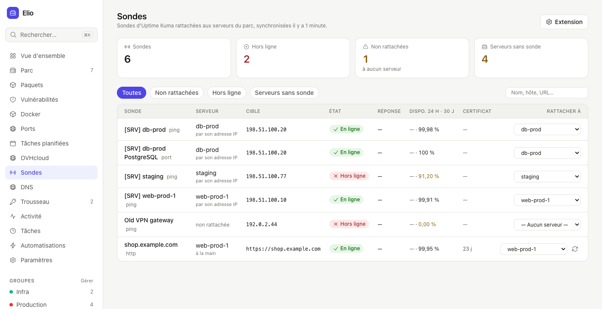 | 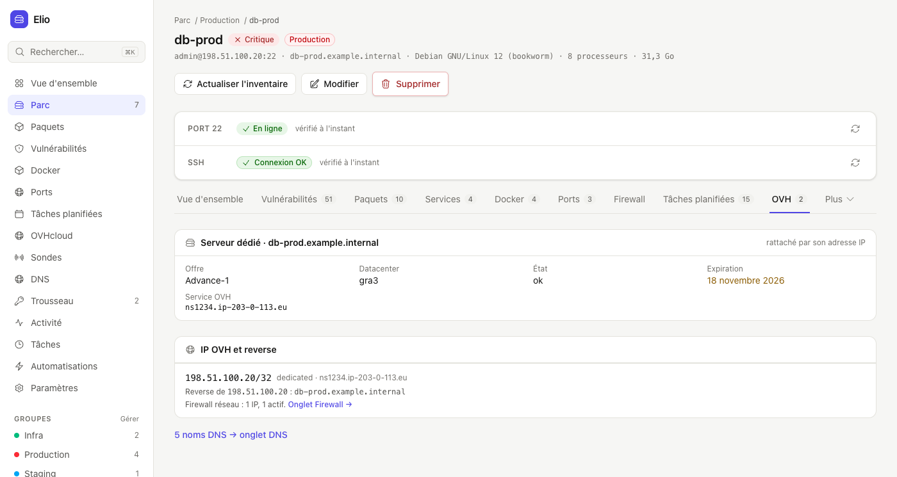 |
| **Uptime Kuma** : les sondes rattachées à chaque serveur | **OVHcloud** : service, IP et reverse |
| 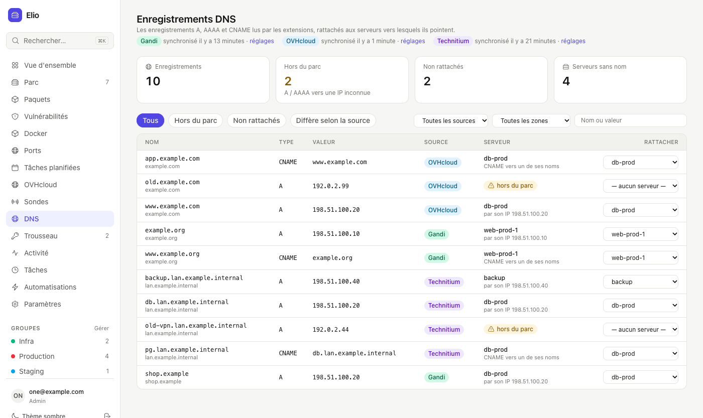 | 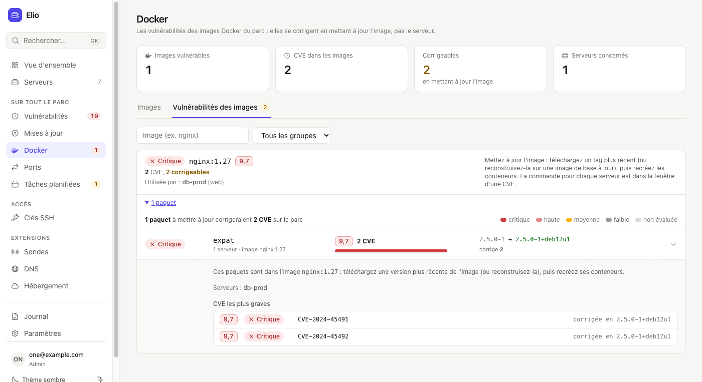 |
| **DNS du parc** : OVHcloud, Technitium et Gandi ensemble | **CVE des images Docker**, par image |
| 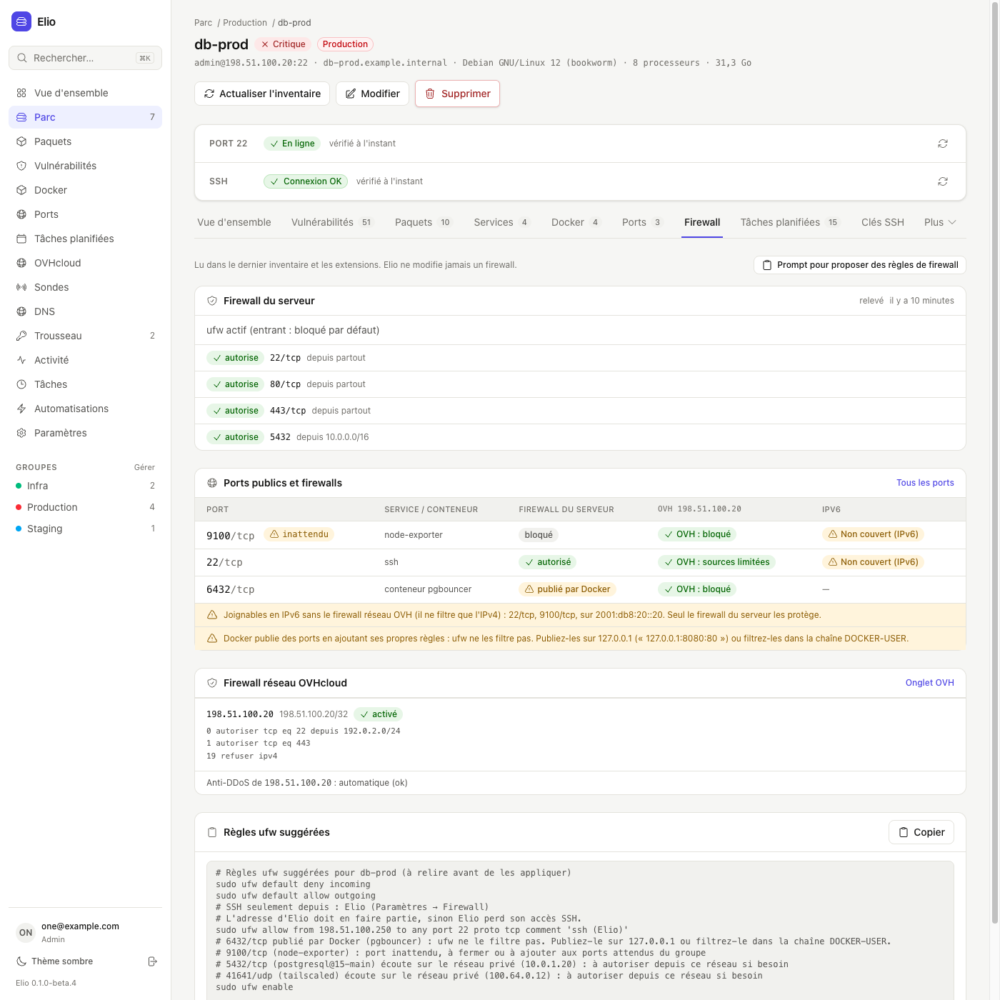 | 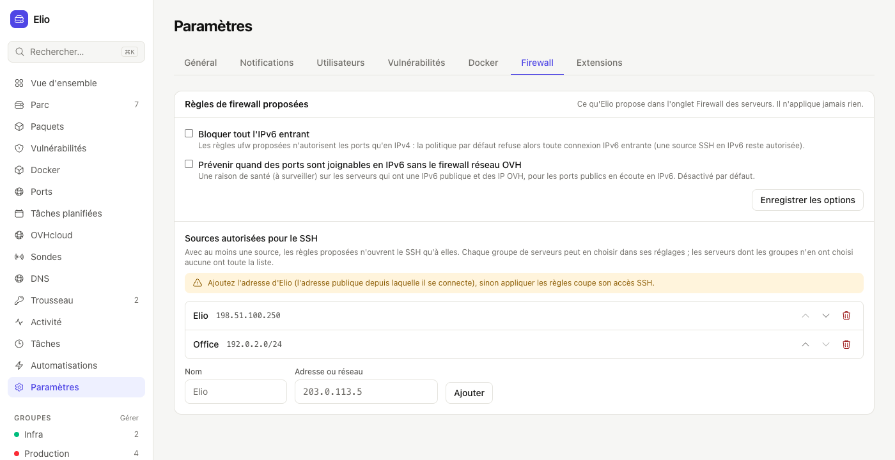 |
| **Firewall** : celui du serveur et celui d'OVH, port par port, IPv6 compris | **Règles proposées** : sources SSH, IPv6 entrant |

L'interface existe en **anglais et en français**. Chaque utilisateur choisit sa langue dans *Mon compte* ; sinon Elio suit le navigateur, puis la langue par défaut de l'installation (*Paramètres → Général*). Les canaux de notification et les invitations ont leur propre langue. Ajouter une langue, c'est ajouter un dossier de traductions : voir [CONTRIBUTING.md](CONTRIBUTING.md#translating-elio).

## Démarrage rapide

Avec Docker :

```sh
mkdir elio && cd elio
curl -fsSLO https://raw.githubusercontent.com/elio-fleet/elio/main/docker-compose.yml
docker run --rm ghcr.io/elio-fleet/elio:beta bin/elio-keys > .env    # les secrets de votre installation
echo "ELIO_DATABASE_PASSWORD=$(openssl rand -hex 24)" >> .env
docker compose up -d
```

Ouvrez <http://localhost:8080> et créez le premier compte : c'est l'administrateur. Puis, dans *Paramètres → Général*, générez la clé SSH d'Elio, ajoutez-la au `~/.ssh/authorized_keys` d'un serveur, et ajoutez le serveur.

**Gardez `.env` en lieu sûr** : sans ses clés, les données chiffrées (clé SSH d'Elio, clés d'API, webhooks) ne peuvent plus être relues.

## Installation en production

Elio est une application Rails avec PostgreSQL. Placez-la derrière un reverse proxy en HTTPS (Caddy, Traefik, nginx).

- **Docker Compose** : le [`docker-compose.yml`](docker-compose.yml) ci-dessus. Derrière votre proxy HTTPS, définissez `ELIO_HOST` (votre domaine) et retirez `ELIO_FORCE_SSL: "false"`.
- **Kamal** : [`config/deploy.yml`](config/deploy.yml) est prêt (HTTPS avec Let's Encrypt) ; mettez les secrets dans `.kamal/secrets` puis `bin/kamal setup`.
- **Mises à jour** : récupérez la nouvelle image (`docker compose pull && docker compose up -d`) ; les migrations se lancent au démarrage.
- **Sauvegardes** : les bases PostgreSQL et le volume `storage` (empreintes connues des serveurs).

### Configuration

| Variable | |
|---|---|
| `SECRET_KEY_BASE`, `ACTIVE_RECORD_ENCRYPTION_PRIMARY_KEY`, `ACTIVE_RECORD_ENCRYPTION_DETERMINISTIC_KEY`, `ACTIVE_RECORD_ENCRYPTION_KEY_DERIVATION_SALT` | Secrets de l'installation, affichés par `bin/elio-keys`. **Obligatoires.** (Une installation qui les garde dans les credentials Rails définit `RAILS_MASTER_KEY` à la place.) |
| `ELIO_DATABASE_PASSWORD`, `PGHOST` | Mot de passe PostgreSQL de l'utilisateur `elio`, et hôte. Elio utilise quatre bases : `elio_production`, `_cache`, `_queue`, `_cable`. |
| `ELIO_HOST` | Le domaine d'Elio : liens des emails et des notifications, et seul nom d'hôte auquel il répond. |
| `ELIO_SETUP_TOKEN` | S'il est défini, demandé à la création du premier compte (utile si Elio est joignable avant que vous le configuriez). |
| `ELIO_FORCE_SSL` | `false` seulement pour essayer Elio en HTTP simple. Sinon, HTTPS est forcé. |
| `SMTP_ADDRESS`, `SMTP_PORT`, `SMTP_USERNAME`, `SMTP_PASSWORD`, `SMTP_AUTHENTICATION`, `ELIO_MAIL_FROM` | Emails : invitations, mot de passe oublié, notifications. Sans `SMTP_ADDRESS`, les liens d'invitation sont à copier. |
| `ELIO_PARALLEL_LIMIT` | Serveurs collectés en même temps (4). |
| `ELIO_ACTIVITY_RETENTION_DAYS` | Durée de conservation du journal d'activité (365, `0` = tout garder). |
| `ELIO_DEBIAN_TRACKER_URL`, `ELIO_UBUNTU_OSV_URL`, `ELIO_NVD_FEED_URL`, `ELIO_EPSS_URL`, `ELIO_KEV_URL` | Miroirs des bases de vulnérabilités, pour un réseau fermé (elles peuvent aussi être importées à la main). |

Tout le reste — seuils, notifications, automatisations, fournisseurs de notes, registres Docker, [extensions](#extensions) — se règle dans l'interface, par un administrateur. Les secrets qui y sont saisis (clés d'API, jetons, webhooks) sont chiffrés en base.

### Préparer les serveurs

1. Dans *Paramètres → Général*, générez la clé SSH d'Elio (Ed25519, gardée chiffrée).
2. Ajoutez sa clé publique au `~/.ssh/authorized_keys` du compte qu'Elio utilisera (la page donne la commande).
3. Ajoutez le serveur (ou importez-en plusieurs depuis un CSV ou votre `~/.ssh/config`), puis lancez un inventaire.

Elio lit tout ce qu'un compte sans privilège peut lire. Certains détails demandent root — le processus derrière chaque port, le firewall, Docker, les crontabs des utilisateurs, les clés SSH des autres comptes : connectez Elio en root, ou donnez au compte un `sudo` sans mot de passe. Sans cela, ces collectes sont marquées *partielles*, et seules les clés du compte d'Elio sont listées.

Pris en charge : **Debian et Ubuntu** (les autres systèmes : santé et système seulement), Docker, snap.

## Ce qu'Elio exécute sur vos serveurs

**Toutes les commandes sont dans [`config/ssh_commands.yml`](config/ssh_commands.yml)**, rangées par rôle puis par distribution. C'est le seul endroit où elles sont écrites : l'application les lit de là, et un test échoue si une commande est envoyée d'ailleurs. Les valeurs insérées sont toujours échappées.

| Pour | Commandes (lecture seule) |
|---|---|
| Système, réseau | `/etc/os-release`, `uname`, `hostname`, `systemd-detect-virt`, `/proc`, `timedatectl`, `ip -j addr`, `ip -j link` |
| Santé | `/proc/loadavg`, `/proc/meminfo`, `df`, `/var/run/reboot-required`, `systemctl --failed`, `apt-get -s dist-upgrade` (simulation) |
| Paquets | `dpkg-query -W`, `apt list --upgradable`, `snap list` |
| Services, tâches planifiées | `systemctl list-units`, `list-unit-files`, `show` des timers, `/etc/crontab`, `/etc/cron.d`, `/var/spool/cron` |
| Docker | `docker inspect` (état, santé, redémarrages — **jamais les variables d'environnement**), `docker stats`, `docker image inspect`, `docker system df`, `trivy` / `grype` s'ils sont installés, `docker cp` de `os-release` et de l'état dpkg |
| Ports | `ss -tulpn`, `/proc/<pid>/cgroup`, `ufw status verbose`, `nft list ruleset`, `iptables -S INPUT` |
| Clés SSH | lecture de `~/.ssh/authorized_keys` (avec root, de chaque compte qui a un shell — jamais à travers un lien, ni un fichier qui n'appartient pas au compte) ; **écriture seulement** quand vous ajoutez une clé (au compte d'Elio) ou en retirez une |

Elio **ne modifie jamais le firewall** et n'installe rien : les règles ufw suggérées et les commandes de mise à jour sont à relire et à lancer vous-même.

### L'onglet Firewall

Chaque serveur a un onglet **Firewall** : les règles de son propre firewall (ufw, nftables ou iptables, lues en root), le firewall réseau OVHcloud de ses IP OVH et son anti-DDoS, et un tableau de ses ports publics avec le verdict de chaque firewall côte à côte. Le firewall OVHcloud ne filtre **que l'IPv4** : sur un serveur qui a une adresse IPv6 publique, les ports en écoute en IPv6 sont marqués *non couvert (IPv6)*, et une raison de santé peut les signaler (*Paramètres → Firewall*).

Les **règles ufw proposées** peuvent n'ouvrir le SSH qu'aux sources que vous listez dans *Paramètres → Firewall* (l'adresse d'Elio, Coolify, votre bureau… — chaque groupe de serveurs peut en choisir ; mettez-y l'adresse d'Elio, sinon appliquer les règles coupe son accès), et peuvent **bloquer tout l'IPv6 entrant** (les ports ne sont alors autorisés qu'en IPv4). Le prompt du firewall pour une IA se termine par vos propres consignes (*Paramètres → Général*), par exemple « pour le port SSH, mets les règles toujours en dernier ».

## Extensions

Elio peut lire ce que savent vos autres outils et l'afficher à côté de chaque serveur. Activez-les dans *Paramètres → Extensions* (administrateurs). Elles **ne font que lire** : Elio ne crée, ne modifie et ne supprime jamais rien sur ces services, et une extension désactivée ne laisse aucune trace dans l'interface. Chaque alerte qu'elles lèvent est au choix, avec son seuil.

### Uptime Kuma

- **Réglage** : l'adresse de votre instance et une clé d'API (*Uptime Kuma → Paramètres → Clés API*). *Tester la connexion* les vérifie avant d'enregistrer.
- Elio lit la page `/metrics` toutes les 15 minutes (Uptime Kuma 1.x et 2.x) et **rattache chaque sonde à son serveur** : par l'IP surveillée (adresses WireGuard comprises), par le nom d'hôte (avec résolution DNS en option), ou par le nom du serveur dans celui de la sonde (`[SRV] web-prod-1`). Un rattachement se corrige à la main et reste gardé.
- Un onglet **Sondes** sur chaque serveur (état, temps de réponse, disponibilité sur 24 h et 30 jours, certificat) et une page **Sondes** : sondes rattachées à aucun serveur, serveurs sans sonde.
- Alertes au choix : serveur sans sonde (avec des groupes à ignorer), sonde hors ligne ou de retour, certificat bientôt expiré, disponibilité sous un seuil, sonde en maintenance depuis trop longtemps.

### OVHcloud

- **Réglage** : le point d'accès de l'API (EU, CA, US), une Application Key, un Application Secret et une Consumer Key **limitée aux requêtes GET**. *Droits à donner à la clé API* liste les droits exacts pour les produits cochés et ouvre la page de création de jeton d'OVH déjà remplie. *Tester la connexion* signale les droits manquants, et **prévient si la clé permet d'écrire** — refaites-en une dans ce cas.
- Chaque produit est une case à cocher : IP et reverse DNS, firewall réseau, anti-DDoS, zones DNS (toutes ou certaines), serveurs dédiés, VPS, instances Public Cloud (tous les projets ou certains).
- Un onglet **OVH** sur chaque serveur : le service OVH (offre, datacenter, expiration), ses IP et reverse ; les règles du firewall réseau, **si elles laissent passer chaque port public** et l'anti-DDoS sont dans l'[onglet Firewall](#longlet-firewall). Une page **OVHcloud** : services, IP, ressources rattachées à aucun serveur. Ses enregistrements DNS vont dans le [DNS du parc](#dns-du-parc).
- Alertes au choix : service bientôt expiré (renouvellement automatique pris en compte), firewall réseau désactivé, reverse DNS qui ne correspond pas, service OVH non suivi par Elio.

Le client OVH d'Elio ne connaît que la méthode GET : il ne peut pas écrire, quels que soient les droits de la clé.

### DNS du parc

Les extensions qui lisent du DNS (OVHcloud avec son produit DNS, Technitium DNS, Gandi) alimentent **un seul DNS du parc** :
- chaque enregistrement A, AAAA et CNAME est rattaché à son serveur de la même façon, quelle que soit sa source : un rattachement manuel **par nom** (valable pour toutes les sources), l'IP d'un enregistrement A / AAAA, ou un CNAME vers un nom de n'importe quelle source ;
- un seul onglet **DNS** sur chaque serveur et une seule page **DNS** (filtres par source, zone, *hors du parc*, *non rattachés*, *diffère selon la source*), avec la source de chaque enregistrement ;
- un nom dont les enregistrements diffèrent selon la source (une IP publique chez OVH, une IP privée dans Technitium) est signalé *diffère selon la source* ;
- les **alertes** se règlent une fois, dans *Paramètres → Extensions → DNS* : enregistrement vers une IP hors du parc, serveur sans nom DNS (seulement si aucune source n'en a ; des groupes peuvent être ignorés), et en option un nom qui diffère selon la source. Rien n'est signalé pour les premiers enregistrements d'une source qu'on vient d'activer ;
- la recherche du Parc, ⌘K, les sondes Uptime Kuma et les prompts utilisent ces noms.

### Technitium DNS

- **Réglage** : l'adresse de la console web (port 5380 ou 53443) et le jeton d'API d'un utilisateur qui peut seulement **voir** les zones. Technitium a aussi des **droits par zone** : donnez *View* au groupe de cet utilisateur sur chaque zone à lire, sinon le jeton n'en voit aucune. *Tester la connexion* donne la version et les zones lisibles, et prévient si le jeton permet de les modifier.
- Toutes les heures, Elio lit les enregistrements **A, AAAA et CNAME** des zones (toutes, ou celles que vous listez) et rattache chacun à son serveur : par l'IP d'un enregistrement A / AAAA, et pour un CNAME par l'enregistrement ou l'hôte vers lequel il pointe. Un nom peut être rattaché à la main, et le rattachement est gardé.
- Ses enregistrements vont dans le [DNS du parc](#dns-du-parc).
- Le jeton passe dans un en-tête `Authorization: Bearer` (jamais dans l'URL). Testé avec Technitium DNS Server 15.6.

### Gandi

- **Réglage** : un **jeton d'accès personnel** créé dans l'admin Gandi (*Organisations → Jetons d'accès personnels*) avec **seulement les droits de voir les domaines et leurs enregistrements DNS** (LiveDNS), et une expiration que vous renouvellerez ; en option l'ID de l'organisation propriétaire des domaines (sinon Gandi ne liste que ceux de votre organisation personnelle). *Tester la connexion* donne les domaines lisibles et ceux sur LiveDNS.
- Toutes les heures, Elio lit les enregistrements **A, AAAA et CNAME** des domaines servis par LiveDNS (tous, ou ceux que vous listez) et les envoie au [DNS du parc](#dns-du-parc) ; la page de réglages liste vos domaines avec leur date d'expiration et leur renouvellement automatique, et une alerte en option signale un domaine qui va expirer.
- Elio n'envoie que des requêtes `GET` à `https://api.gandi.net/v5/`, le jeton dans un en-tête `Authorization: Bearer`.

## Sécurité

- La clé SSH d'Elio, les clés d'API, les webhooks et les secrets 2FA sont **chiffrés en base** et jamais renvoyés au navigateur.
- Double authentification (TOTP et codes de secours), obligatoire par défaut pour les administrateurs et les opérateurs ; rôles ; invitations seulement (pas d'inscription publique) ; connexion limitée en débit et verrouillage ; Content Security Policy stricte.
- L'empreinte de chaque serveur est mémorisée à la première connexion ; un changement bloque la connexion jusqu'à ce qu'un administrateur l'accepte.
- **Connexions sortantes** d'Elio : les bases de vulnérabilités et fournisseurs de notes (Debian, OSV, NVD, Red Hat, CVE.org, FIRST, CISA — seulement les versions et CVE de votre parc), les registres Docker (requêtes `HEAD` sur les manifestes), et les extensions que vous activez (votre instance Uptime Kuma, l'API OVH, votre serveur Technitium DNS, l'API Gandi — en lecture seule, voir [Extensions](#extensions)). Rien d'autre, aucune télémétrie. En réseau fermé, les bases peuvent être importées à la main.
- L'image Docker est construite sur Debian 13 et prend les mises à jour de sécurité Debian à chaque construction ; les CVE qu'Elio peut lister dans son propre conteneur sont celles que Debian n'a pas encore corrigées (voir [SECURITY.md](SECURITY.md#the-docker-image)).
- Vous avez trouvé une faille ? Signalez-la en privé : voir [SECURITY.md](SECURITY.md).

## Limites connues

- Inventaire complet pour **Debian et Ubuntu** seulement. Ubuntu n'a pas encore été essayé sur un vrai serveur.
- Les extensions Uptime Kuma, OVHcloud et Gandi ont été construites sur des réponses d'API enregistrées ou documentées, pas encore essayées sur un vrai compte (Technitium DNS a été essayé sur une vraie instance).
- CVE des images Docker sans Trivy ni Grype : images Debian et Ubuntu seulement (pas Alpine). Trivy et Grype n'ont pas encore été essayés sur un vrai serveur.
- Paquets EFI signés (grub, shim, fwupd) : vérifiés sur les données réelles des dépôts, pas encore sur un vrai serveur EFI.
- Debian note peu de ses CVE : les notes viennent des fournisseurs que vous activez (NVD, Red Hat, CVE.org par défaut).

## Développement

```sh
bin/setup                 # gems, base de données, puis l'app sur http://localhost:3000
bin/rails test            # tests
bin/ci                    # ce que lance la CI : style, audits de sécurité, tests, tests système
```

Ruby (voir `.ruby-version`), PostgreSQL, Chrome pour les tests système. Voir [CONTRIBUTING.md](CONTRIBUTING.md) (en anglais) pour les conventions et l'organisation du code.

Construit avec Ruby on Rails 8, Hotwire, Tailwind CSS, Solid Queue et [net-ssh](https://github.com/net-ssh/net-ssh).

## Licence

[AGPL-3.0](LICENSE). Vous pouvez utiliser, modifier et héberger Elio ; si vous le proposez en service à d'autres, partagez vos modifications.
